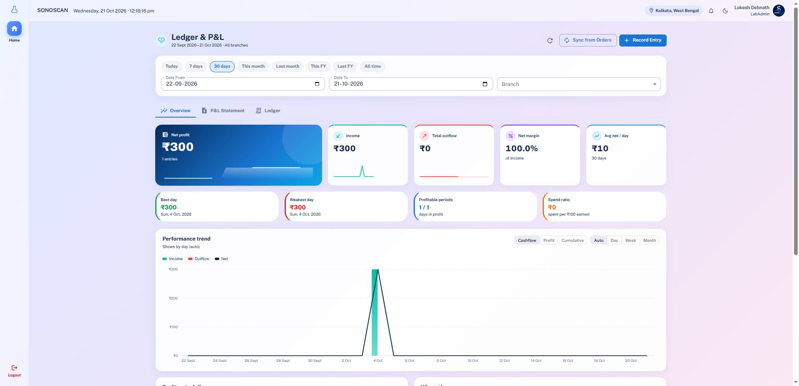
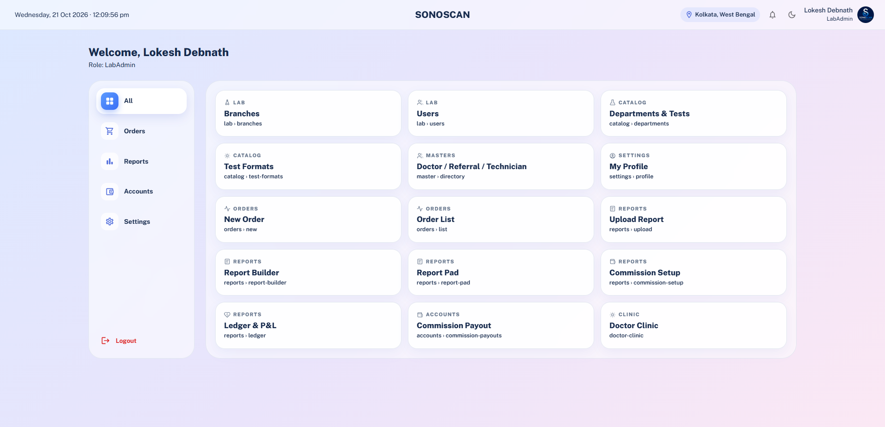
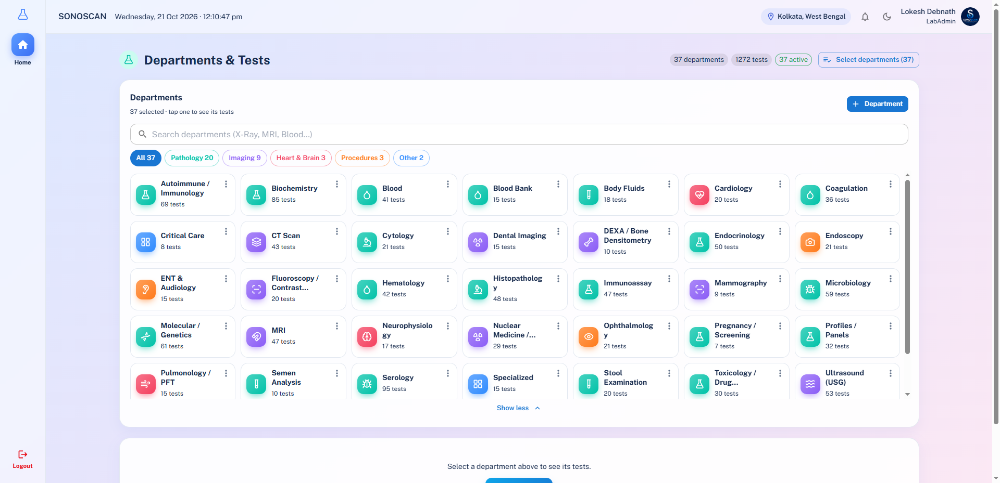
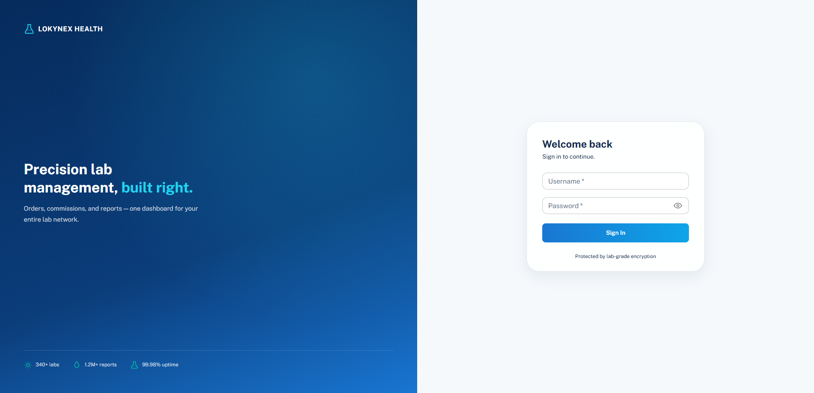
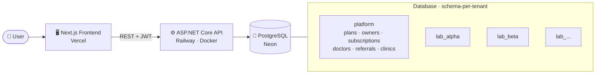
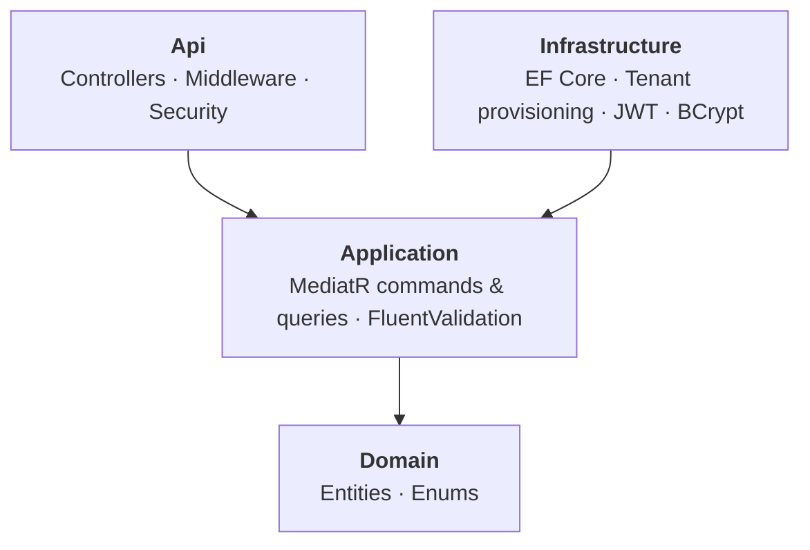

<div align="center">


<br />

[](https://lokynex-health-five.vercel.app/login)
[](https://github.com/Programmerlokesh/lokynex_health/actions)
[](https://github.com/Programmerlokesh/lokynex_health/commits/main)
[](https://github.com/Programmerlokesh/lokynex_health/stargazers)

<br />


<br />

**[Overview](#-overview)** ·
**[Screenshots](#-screenshots)** ·
**[Features](#-features)** ·
**[Architecture](#-architecture)** ·
**[Getting Started](#-getting-started)** ·
**[Deployment](#-deployment)** ·
**[Roadmap](#-roadmap)**

</div>

<br />

## 🔭 Overview

**Lokynex Health** gives every diagnostic lab its own **isolated, secure workspace** to run daily operations: patient orders, test reports, doctor and referral commissions, and full accounting. The platform owner controls labs, plans and subscriptions from a dedicated **SuperAdmin console**.

<div align="center">

| 🏢 Multi-tenant | 🧪 Test catalog | 🛡️ Secure | 📱 Responsive |
| :---: | :---: | :---: | :---: |
| One database schema **per lab** | **37 departments**<br/>**1,200+ tests** ready to use | **JWT** auth, **BCrypt**,<br/>role + module permissions | Works on **desktop,<br/>tablet and mobile** |

</div>

> 🔗 **Try it live:** [lokynex-health-five.vercel.app](https://lokynex-health-five.vercel.app/login)

---

## 📸 Screenshots

<div align="center">

### 📊 Ledger & P&L

<sub>Date presets, KPI cards, best / weakest day and a performance trend chart, with separate P&L Statement and Ledger tabs.</sub>

<br /><br />

### 🏠 Lab Dashboard

<sub>Every module one click away, grouped under Orders, Reports, Accounts and Settings.</sub>

<br /><br />

### 🧪 Departments & Tests

<sub>Pathology, Imaging, Heart & Brain and Procedures, with search and category filters.</sub>

<br /><br />

### 🔐 Secure Login

<sub>Split-screen brand panel with a clean sign-in card.</sub>

</div>

---

## ✨ Features

<table>
<tr>
<td width="33%" valign="top">

#### 🧾 Orders & Billing
- Create, edit, pay and delete orders
- Soft delete with **restore**
- Full **audit log** of every change
- Discounts and payment tracking

</td>
<td width="33%" valign="top">

#### 🧬 Reports
- Pick patient + test, the **format loads automatically**
- Report Builder, Report Pad and Templates
- Custom header / footer or blank space for letterhead
- **Print, PDF download** and public report links

</td>
<td width="33%" valign="top">

#### 🧪 Test Catalog
- **37 departments, 1,200+ tests** pre-loaded
- Editable prices, normal ranges and formats
- Specimen defaults per test
- Add your own departments and tests

</td>
</tr>
<tr>
<td width="33%" valign="top">

#### 💸 Commissions
- Doctor, referral and technician commission
- Per-order-line overrides
- Payout tracking
- Doctor and referral commission can **never overlap** (enforced in the database)

</td>
<td width="33%" valign="top">

#### 📊 Ledger & P&L
- KPI cards: net profit, income, outflow, margin
- **Performance trend** chart (cashflow, profit, cumulative)
- P&L Statement and Ledger tabs
- **Sync from Orders** and manual entries

</td>
<td width="33%" valign="top">

#### 👥 Team & Access
- Branches, users and roles
- **Module-level permissions**
- Global doctor / referral directory
- **Per-lab overrides** without touching the global record

</td>
</tr>
<tr>
<td width="33%" valign="top">

#### 🩺 Doctor Clinic
- Patients and appointments
- Prescriptions with custom **Rx layout**
- Medicine catalog
- Clinic ledger, users and settings

</td>
<td width="33%" valign="top">

#### 👑 SuperAdmin Console
- Manage labs and owners / staff
- Plans and subscriptions
- Module catalog
- Platform-level notifications

</td>
<td width="33%" valign="top">

#### 🎨 Experience
- Fully **mobile responsive**
- Light / dark mode
- Smooth animations
- Clean, modern UI

</td>
</tr>
</table>

---

## 🏛 Architecture

### System overview



### Multi-tenancy

Every lab lives in its **own PostgreSQL schema** (`lab_<code>`), so tenant data is isolated by design. Shared SuperAdmin data lives in the `platform` schema.

When a new lab is created, the backend provisions it in **one transaction**. If anything fails, the whole schema is rolled back, so you never end up with a half-created lab.

### Backend: Clean Architecture



---

## 🧱 Tech Stack

<table>
<tr>
<td><b>🖥️ Frontend</b></td>
<td>Next.js 16 (App Router) · React 19 · TypeScript · Tailwind CSS 4 · MUI · shadcn/ui · TanStack Query · Zustand · Framer Motion</td>
</tr>
<tr>
<td><b>⚙️ Backend</b></td>
<td>ASP.NET Core (.NET 10) · MediatR (CQRS) · FluentValidation · EF Core + Npgsql · Swagger</td>
</tr>
<tr>
<td><b>🔐 Security</b></td>
<td>JWT Bearer authentication · BCrypt password hashing · role and module-permission checks</td>
</tr>
<tr>
<td><b>🐘 Database</b></td>
<td>PostgreSQL (schema-per-tenant)</td>
</tr>
<tr>
<td><b>🚢 DevOps</b></td>
<td>Docker · GitHub Actions · Vercel · Railway · Neon</td>
</tr>
</table>

---

## 📁 Project Structure

<details>
<summary><b>Click to expand</b></summary>

<br />

```text
lokynex_health/
├── .github/workflows/ci.yml          # Backend CI (build + test)
├── docs/                             # Banner + README screenshots
│   ├── banner.svg
│   └── screenshots/
├── database/                         # SQL scripts + seed runner
│   ├── 001_platform.sql
│   ├── 002_tenant_schema.sql
│   ├── 003_departments_and_tests.sql
│   ├── 031_doctor_clinic.sql
│   ├── 032_clinic_rx_layout.sql
│   └── run-seeds.mjs
└── LokynexHealth/
    ├── backend/
    │   ├── Dockerfile
    │   └── src/
    │       ├── LokynexHealth.Api/             # Controllers, middleware, security
    │       ├── LokynexHealth.Application/     # Commands, queries, validators
    │       ├── LokynexHealth.Domain/          # Entities, enums
    │       └── LokynexHealth.Infrastructure/  # EF Core, provisioning, SQL scripts
    └── frontend/
        └── src/
            ├── app/            # Routes: (dashboard), clinic, owner, superadmin, login
            ├── components/     # UI by feature
            ├── lib/api/        # API clients
            ├── store/          # Zustand stores
            ├── hooks/
            └── types/
```

</details>

---

## 🚀 Getting Started

### Prerequisites

| Tool | Version |
| --- | --- |
| Node.js | 20+ |
| .NET SDK | 10 |
| PostgreSQL | Local, or a free [Neon](https://neon.tech) database |

### 1 · Clone

```bash
git clone https://github.com/Programmerlokesh/lokynex_health.git
cd lokynex_health
```

### 2 · Database

Run the scripts from `database/` in this order:

| # | File | Run |
| :-: | --- | --- |
| 1 | `001_platform.sql` | once per database |
| 2 | `002_tenant_schema.sql` | once per lab (`SET search_path TO lab_xxx, public;`) |
| 3 | `003_departments_and_tests.sql` | once per lab |
| 4 | `031_doctor_clinic.sql` | once per database |
| 5 | `032_clinic_rx_layout.sql` | once per database (after 031) |

> 💡 All scripts are safe to re-run. Labs created from inside the app get steps 2 and 3 automatically.
> More details in [`database/README.md`](database/README.md).

### 3 · Backend

Create `LokynexHealth/backend/src/LokynexHealth.Api/appsettings.Development.json` (already git-ignored):

```json
{
  "ConnectionStrings": {
    "TenantDb": "Host=localhost;Database=lokynex;Username=postgres;Password=YOUR_PASSWORD"
  },
  "Jwt": {
    "Secret": "use-a-long-random-secret-at-least-32-characters"
  }
}
```

```bash
cd LokynexHealth/backend
dotnet restore LokynexHealth.slnx
dotnet run --project src/LokynexHealth.Api
```

API runs at **http://localhost:5213** (Swagger available in development).

### 4 · Frontend

Create `LokynexHealth/frontend/.env.local`:

```env
NEXT_PUBLIC_API_BASE_URL=http://localhost:5213
```

```bash
cd LokynexHealth/frontend
npm install
npm run dev
```

Open **http://localhost:3000** 🎉

### 5 · First login

`001_platform.sql` seeds the first **SuperAdmin** (username: `superadmin`).

> ⚠️ **Change the password immediately after your first login.**

---

## ⚙️ Environment Variables

<details>
<summary><b>Backend</b></summary>

<br />

| Variable | Description |
| --- | --- |
| `ConnectionStrings__TenantDb` | PostgreSQL connection string |
| `Jwt__Secret` | Secret used to sign JWT tokens (keep private) |
| `Jwt__Issuer` / `Jwt__Audience` | JWT issuer / audience (defaults in `appsettings.json`) |
| `AllowedOrigins` | Extra CORS origins, comma-separated |
| `PORT` | Injected by Railway; Kestrel binds to it automatically |

</details>

<details>
<summary><b>Frontend</b></summary>

<br />

| Variable | Description |
| --- | --- |
| `NEXT_PUBLIC_API_BASE_URL` | Base URL of the backend API |

</details>

---

## 🐳 Docker

```bash
cd LokynexHealth/backend
docker build -t lokynex-health-api .
docker run -p 8080:8080 \
  -e ConnectionStrings__TenantDb="<your-connection-string>" \
  -e Jwt__Secret="<your-secret>" \
  lokynex-health-api
```

---

## ☁️ Deployment

| Service | Platform | Setup |
| --- | --- | --- |
| 🖥️ Frontend | **Vercel** | Root directory `LokynexHealth/frontend` · set `NEXT_PUBLIC_API_BASE_URL` |
| ⚙️ Backend | **Railway** | Root directory `LokynexHealth/backend` (uses the `Dockerfile`) · set backend env vars |
| 🐘 Database | **Neon** | Use the non-pooled connection string for running seed scripts |

---

## 🔄 Continuous Integration

The **CI - Backend** workflow runs on every push and pull request to `main` that touches `LokynexHealth/backend/**`:

`Restore` → `Build (Release)` → `Test`

---

## 🔒 Security

- Passwords are hashed with **BCrypt**
- APIs are protected with **JWT** plus role and module-permission checks
- Tenant data is isolated in **separate database schemas**
- Secrets are never committed. Use environment variables or the git-ignored `appsettings.Development.json`

---

## 🗺 Roadmap

- [x] Multi-tenant lab platform (schema-per-tenant)
- [x] Orders, billing and audit log
- [x] Blood report formats, print and PDF
- [x] Commission management and payouts
- [x] Ledger & P&L with charts
- [x] Doctor Clinic module
- [x] SuperAdmin console (plans, subscriptions)
- [ ] WhatsApp report sharing
- [ ] Automated backend test coverage
- [ ] Analytics dashboard improvements

---

## 📄 License

All rights reserved © 2026 Lokynex.

<br />

<div align="center">

### Built with ❤️ by [Lokesh Debnath](https://github.com/Programmerlokesh)

[🌐 Live Demo](https://lokynex-health-five.vercel.app/login) ·
[🐛 Report a Bug](https://github.com/Programmerlokesh/lokynex_health/issues) ·
[⭐ Star this repo](https://github.com/Programmerlokesh/lokynex_health)

<sub>If you find this project useful, a star would mean a lot.</sub>

</div>
